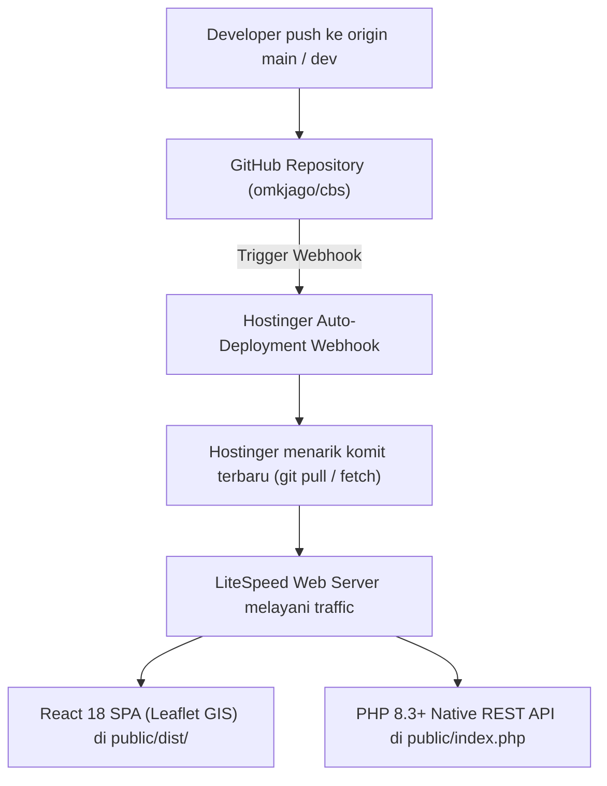

# 🚀 PANDUAN LENGKAP DEPLOYMENT HOSTINGER (GIT DEPLOYMENT) & ARSITEKTUR SISTEM
# SISTEM MONITORING JARINGAN MULTI-VENDOR & GIS FIBER OPTIK (NMS-GIS ISP)

Dokumen ini merupakan panduan resmi bagi Tim Engineer dan Sysadmin untuk melakukan deployment dan pemeliharaan sistem **NMS-GIS ISP** pada server hosting **Hostinger (LiteSpeed Web Server & hPanel)** menggunakan fitur bawaan **Hostinger Git Deployment (Clone langsung dari GitHub)**.

---

## 1. IKHTISAR ALUR DEPLOYMENT HOSTINGER

Karena repositori bersifat publik, proses deployment tidak memerlukan runner eksternal maupun manajemen secret SSH yang rumit. Alur deployment berjalan secara instan dan native:



---

## 2. PANDUAN SETTING HOSTINGER GIT DEPLOYMENT (LANGKAH DEMI LANGKAH)

### A. Menghubungkan Repositori di Hostinger hPanel

1. Buka browser dan login ke **Hostinger hPanel**.
2. Masuk ke menu **Websites** $\rightarrow$ pilih domain/subdomain **`cbs.bawananusantara.com`**.
3. Di panel menu samping kiri, buka bagian **Advanced** $\rightarrow$ klik **Git**.
4. Pada form **Create a Repository**:
   * **Repository**: `https://github.com/omkjago/cbs.git`
   * **Branch**: `main` (untuk server produksi) atau `dev` (untuk staging)
   * **Install Path**: Sesuaikan dengan folder subdomain Anda (contoh: `public_html/cbs`).
5. Klik **Create**. Hostinger akan mengkloning seluruh file aplikasi, frontend React (`public/dist/`), dan backend PHP secara utuh.

---

### B. Mengaktifkan Otomatisasi Auto-Deploy via GitHub Webhook

Agar Hostinger langsung melakukan update otomatis setiap kali Anda melakukan push ke GitHub:

1. Di tabel repositori menu **Git** Hostinger hPanel, cari repositori yang telah aktif.
2. Temukan kolom **Auto-Deployment** dan salin tautan URL **Webhook** yang tercantum (format: `https://hpanel.hostinger.com/api/git/deploy/...`).
3. Buka repositori Anda di GitHub: `https://github.com/omkjago/cbs/settings/hooks`.
4. Klik tombol **Add webhook**.
5. Masukkan pengaturan berikut:
   * **Payload URL**: Tempelkan tautan Webhook dari Hostinger tadi.
   * **Content type**: Pilih `application/json`.
   * **Secret**: (Kosongkan kecuali Hostinger memberikan secret token khusus).
   * **Which events would you like to trigger this webhook?**: Pilih `Just the push event`.
   * **Active**: Pastikan tercentang.
6. Klik **Add webhook**. Setiap `git push origin main` atau `dev` sekarang akan memicu pembaruan otomatis di Hostinger dalam hitungan detik.

---

## 3. KONFIGURASI FILE ENVIRONMENT (`.env`) & DATABASE

1. Masuk ke **hPanel** $\rightarrow$ **File Manager** $\rightarrow$ buka folder instalasi aplikasi (misal: `public_html/cbs/`).
2. Buat file baru bernama `.env` (atau salin dari `.env.example`).
3. Masukkan konfigurasi produksi sesuai kredensial database MySQL Anda di Hostinger:

```env
# ==============================================================================
# NMS-GIS ISP - Production Environment Configuration (Hostinger)
# ==============================================================================

APP_NAME="NMS-GIS Fiber Optic Monitoring"
APP_ENV=production
APP_DEBUG=false
APP_URL=https://cbs.bawananusantara.com

# Database MySQL Produksi (Hostinger Database)
DB_DRIVER=mysql
DB_HOST=127.0.0.1
DB_PORT=3306
DB_DATABASE=u123456789_nms
DB_USERNAME=u123456789_nmsuser
DB_PASSWORD=PasswordDatabaseSangatKuat_2026!
DB_CHARSET=utf8mb4

# Master Key Enkripsi AES-256-GCM (Wajib 64 Karakter Hex)
APP_KEY=0123456789abcdef0123456789abcdef0123456789abcdef0123456789abcdef

# Stateless JWT Authentication Secret Token
JWT_SECRET=c2VjdXJlX2p3dF9zZWNyZXRfdG9rZW5faXNwXzIwMjZfbXNnaXNfcHJvZHVjdGlvbg==
JWT_EXPIRATION=3600
JWT_REFRESH_EXPIRATION=604800

# CORS Allowed Origin
CORS_ALLOWED_ORIGINS=https://cbs.bawananusantara.com

# Ambang Batas Optical Power Meter (OPM dBm)
RX_POWER_WARNING_THRESHOLD=-25.00
RX_POWER_CRITICAL_THRESHOLD=-28.00
```

---

## 4. EKSEKUSI MIGRASI DATABASE AWAL

Setelah file `.env` terkonfigurasi:
1. Buka **Web Terminal** di hPanel atau akses SSH server Anda.
2. Masuk ke folder proyek dan jalankan:
   ```bash
   php database/migrate.php
   ```
3. Output akan memverifikasi pembuatan tabel skema InnoDB, indeks koordinat spasial GIS, user default Super Admin (`admin@nms.isp` / `Admin123!@#`), dan seed topologi GIS contoh.

---

## 5. PENJADWALAN BACKGROUND WORKER (CRON JOBS DI HOSTINGER)

Buka menu **Advanced** $\rightarrow$ **Cron Jobs** di Hostinger hPanel:

1. **Poller Engine Worker (Setiap 2 Menit)**:
   * **Common Settings**: `*/2 * * * *` (Every 2 minutes)
   * **Command**: `/usr/bin/php /home/uXXXX/domains/bawananusantara.com/public_html/cbs/workers/poller_worker.php >/dev/null 2>&1`
2. **Auto-Purge Temporary Logs (Harian Pukul 03:00 WIB)**:
   * **Common Settings**: `0 3 * * *` (Once a day at 03:00)
   * **Command**: `/usr/bin/php /home/uXXXX/domains/bawananusantara.com/public_html/cbs/workers/cleanup_temp_logs.php >/dev/null 2>&1`
